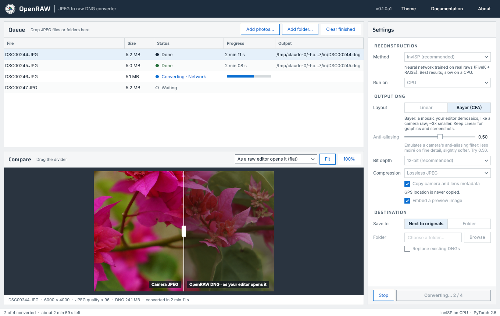
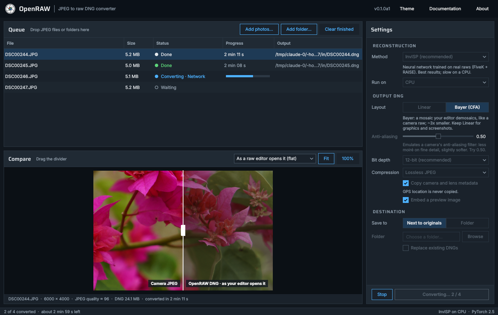
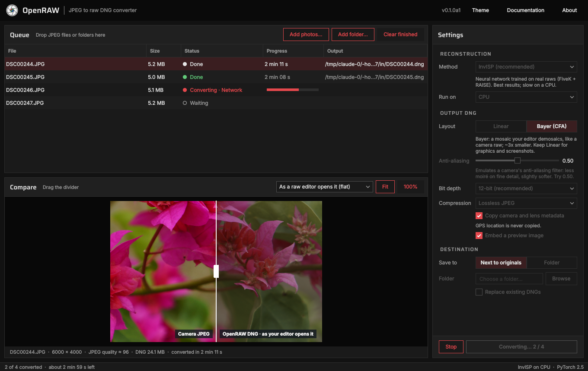
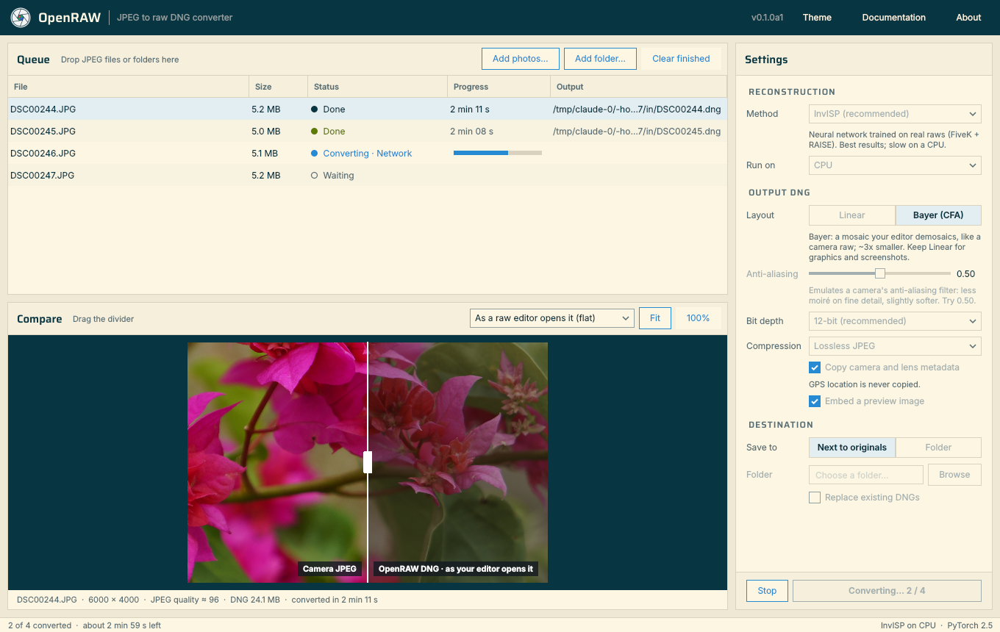
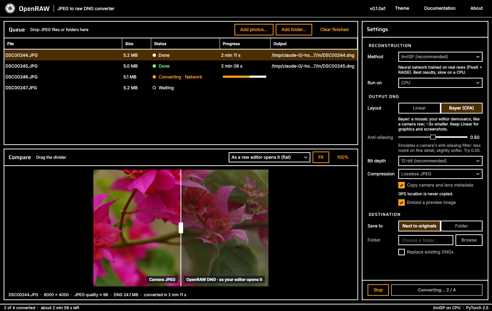
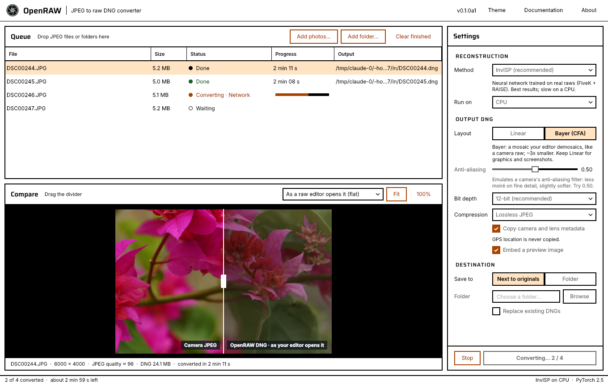

# The OpenRAW desktop app



A front end over the same pipeline as the `openraw` command: same
conversions, same DNGs, same safety rules (existing DNGs are skipped unless
you ask, an interrupted conversion never leaves a half-written file).

## Getting it

**Downloads** — [releases page](https://github.com/Swarce/OpenRAW/releases):

| File | For | Notes |
|---|---|---|
| `OpenRAW-<version>-windows-x64.zip` | Windows 10/11, 64-bit | unzip anywhere, run `OpenRAW.exe` |
| `OpenRAW-<version>-macos-arm64.zip` | macOS 11+ on Apple silicon | unzip, drag `OpenRAW.app` to Applications |
| `OpenRAW-<version>-linux-x64.tar.gz` | Linux x64 (glibc 2.35+: Ubuntu 22.04, Fedora 36 and newer) | extract, run `OpenRAW/OpenRAW` |

Each is self-contained (Python, Qt, PyTorch for the CPU, and both InvISP
models): a 280 MB download for Windows and macOS, 430 MB for Linux. Intel
Macs: use the source install below.

**From source**, with the command line alongside:

```bash
pip install ".[gui]"          # + ".[invisp]" for the InvISP models (PyTorch)
openraw-gui                   # or: python -m openraw.gui
openraw-gui ~/Pictures/trip   # start with photos already in the queue
```

### First launch

The builds aren't code-signed yet, so the operating system asks once:

- **Windows**: SmartScreen says "Windows protected your PC" → *More info* →
  *Run anyway*.
- **macOS**: "OpenRAW can't be opened because Apple cannot check it" →
  open *System Settings → Privacy & Security* and click *Open Anyway* (or
  right-click the app → *Open*). From a terminal:
  `xattr -dr com.apple.quarantine /Applications/OpenRAW.app`.
- **Linux**: nothing; if double-clicking does nothing, run `./OpenRAW` from a
  terminal to see why (Qt needs `libxkbcommon-x11-0` and `libegl1`).

## Using it

1. **Add photos**: drag JPEGs or folders onto the window, or use *Add
   photos…* / *Add folder…*. Folders are searched recursively.
2. **Settings** (remembered between launches):
   - *Method*: **InvISP (recommended)** is the FiveK + RAISE model `r2-e19`
     (*previous (e14)* is the one before it);
     *upstream Nikon* is the original InvISP authors' model; *Classical*
     needs no neural network and is fast; *Custom checkpoint…* takes a
     `.pth` from your own [training run](training.md).
   - *Run on*: CPU, or an NVIDIA GPU when PyTorch finds one. InvISP takes
     a couple of minutes per 24 MP photo on a laptop CPU, seconds on a GPU.
   - *Layout*: **Linear** (demosaiced) or **Bayer (CFA)**, a mosaic your
     editor demosaics like a camera raw, ~3x smaller.
     *Anti-aliasing* (Bayer only) emulates a camera's optical low-pass
     filter: about half the moiré on fine detail, slightly softer
     ([measurements](dng-format.md#cfa-bayer-layout---layout-cfa)).
   - *Bit depth*, *Compression*, metadata and preview: as the command line's
     `--bit-depth`, `--compression`, `--no-exif`, `--no-preview`.
   - *Save to*: next to the originals, or a folder (subfolders mirrored).
3. **Convert** (Ctrl+Enter). *Stop* ends the current photo at once and
   removes its unfinished file; *Convert* again picks up where it stopped.
4. **Compare**: select a converted photo. The divider splits the camera
   JPEG and the DNG as LibRaw renders it — *flat*, the way a raw editor
   first opens it before applying its own look, or *matched* to the JPEG's
   exposure and white balance to compare colour and detail. *100%* shows
   actual pixels; drag to pan.

Right-click a photo to show its DNG or JPEG in the file manager, or to
remove it from the queue (Delete key works too).

## Themes

*Theme* in the top bar: **Match system** (Light or Dark, following the
operating system), or:

| | |
|---|---|
|  Light |  Dark |
|  Darkroom — neutral greys, safelight red |  Solarized — warm paper tones |
|  High contrast dark — black, white borders, orange accent |  High contrast light — white, black borders, dark orange accent |

Adding a theme is one entry in `THEMES` in
[`openraw/gui/style.py`](../openraw/gui/style.py).

## How it's built

- `openraw/gui/window.py` — the window; `style.py` — themes; `preview.py` —
  the before/after rendering; `worker.py` — conversions in a separate
  process (the window stays responsive, and Stop can end a conversion
  immediately and safely). Each job goes through `cli._convert_one`, the
  command line's own code.
- `tests/test_gui.py` runs the app offscreen in CI: every theme, the queue,
  real conversions, skipping existing files, stopping mid-file.
- Builds: `pyinstaller packaging/openraw.spec`; the
  [release workflow](../.github/workflows/release.yml) builds all three
  platforms and smoke-tests each build by converting a sample photo with
  every bundled model (`--selftest`). It publishes a release when a `v*` tag
  is pushed, or when run from the Actions tab with *publish* ticked (which
  tags the commit `v<version>`, the version in `openraw/_version.py`).
